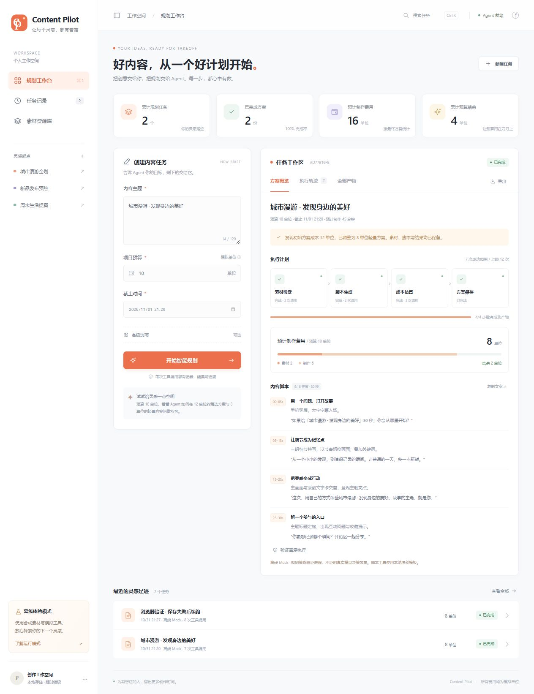

# Content Pilot · 内容任务规划 Agent

面向运营人员的本地内容规划工作台。在预算与截止时间内检索素材、生成脚本、估算费用并保存可执行方案，提供可观察的工具循环、替代方案、持久化与失败续跑。

> **验证边界**：默认离线 Mock 只证明流程与工程约束。已使用用户配置的 `gpt-6.1-sol` 兼容接口实际运行并通过正常、预算 12→8 重规划、工具失败后替代三个场景；原始 Trace、模型元数据和历史失败均见 [真实运行报告](examples/live/README.md)。这三条记录不代表所有真实输入均可靠。业务素材仍为合成文本，脚本工具仍为本地模板，费用均为模拟制作单位。



## 环境与运行

- Node.js **22.9+**（实际验证：24.15.0），随附 npm；Windows/macOS/Linux。
- 零第三方运行依赖，不需要安装前端框架、数据库或 Python。

```bash
npm run dev
```

打开 <http://localhost:3000>。无需 `.env` 即可运行。端口占用时：

```powershell
# PowerShell
$env:PORT=3100
npm run dev
```

```bash
# macOS / Linux
PORT=3100 npm run dev
```

本次本地评审入口使用 <http://localhost:3100>，因为 3000 端口已由其他程序占用。

## 三分钟评审

1. 网页默认主题「城市漫游」、预算 **10**、截止时间为当前时间后 24 小时。点击「开始智能规划」。执行轨迹显示 **12 → 8**，最终保存 8 单位方案。
2. 改预算为 **5**：两种方案均不可行，返回 **3 单位预算缺口**，无已保存方案。
3. 「高级选项」选择「注入一次脚本工具失败」：精选脚本失败后改用轻量素材，检索成功结果保留，失败步骤记录为失败。
4. 选择「注入一次保存失败」：任务未完成但保留脚本和估算；点击「从已有结果继续」，只补跑保存。
5. 点击结果底部「验证重复执行」：复用同一任务编号，不追加调用、不重复计费。刷新页面或重启服务，任务仍可查看。
6. 查看「任务记录」、搜索/筛选、「素材资源库」、「执行轨迹」、「全部产物」，通过「导出」下载完整 JSON。

前端阻止缺少预算或截止时间的提交；HTTP API 同样返回可检查的 `needs_input`，且不调用模型与工具。

## 自动化验证与实际记录

```bash
npm test
npm run examples
```

测试覆盖预算、时间、依赖、失败、部分成功、去重、续跑、调用上限、模型异常和 HTTP 链路。实际结果见 [评估文档](docs/03-evaluation.md)、[运行汇总](examples/summary.json)、[测试报告](examples/test-results.txt)。`examples/01-*.json` 至 `12-*.json` 是脚本真正执行生成的输入、输出与逐步轨迹，包含失败原始状态和续跑后状态。

记录中的截止时间是当次运行时生成的绝对时间。再次验证请运行 `npm run examples`，不要直接复制已经过期的示例截止时间。

## 启用真实模型

将 `.env.example` 复制为 `.env`，在本地填写：

```dotenv
AGENT_MODEL_MODE=openai
OPENAI_API_KEY=你的真实密钥
OPENAI_BASE_URL=https://api.openai.com/v1
OPENAI_MODEL=gpt-4.1-mini
```

重启服务。适配器使用兼容的 Chat Completions JSON 接口；可配置其他兼容服务及模型名，但需自行验证兼容性。真实调用会产生模型服务商费用，不包含在模拟预算中。密钥只在服务端读取，不进入网页或执行记录。模型故障会明确返回 `model_error`，不会悄悄切换到 Mock。

```bash
npm run evaluate:live
```

此命令真正执行正常、预算调整及工具失败三个模型场景，将结果写入 `examples/live/`。缺少密钥会返回非零退出码且不生成虚假记录。提交前应检查是否至少两条真实 Trace 体现模型依据观察调整下一动作；未完成时不能把离线 Trace 当作真实验收证据。

每轮真实 Trace 含运行器记录的模型标识、接口返回 ID（若有）、观察数量与哈希。每次运行写入独立的 `examples/live/runs/<runId>/`，不会覆盖旧证据；`latest.json` 指向本次运行。脚本除 `completed` 外，还必须通过 12→8 的实际预算调整、失败后替代与成功产物保留等行为检查。

```bash
npm run verify:live
npm run report:live
npm run submission:check
```

`verify:live` 从最新原始 Trace 重新校验三场景与不同决策路径。`submission:check` 检查真实证据、正式提交字段和本人贡献披露，缺项时准确返回非零退出码；不能用 `npm test` 通过推断所有考核要求已完成。审计修订详情见 [审计回应](docs/06-audit-response.md)。

不熟悉配置时，打开项目根目录的 `.env`（不要填在 `.env.example` 中），仅在本地填写服务商提供的密钥、基础地址和模型标识；基础地址不要附加 `/chat/completions`。设置 `AGENT_MODEL_MODE=openai`，保存后重启服务。不要将真实密钥粘贴到聊天或提交包中。

## HTTP API

无需 CLI 或网页也可评审。创建是异步操作，返回任务后通过 GET 查看最终状态：

```powershell
$body = @{
  theme = '城市漫游内容活动'
  budget = 10
  deadline = [DateTime]::UtcNow.AddDays(1).ToString('o')
  requestKey = 'review-budget-001'
  scenario = 'normal'
  maxSteps = 12
} | ConvertTo-Json
$result = Invoke-RestMethod -Method Post -Uri http://localhost:3100/api/tasks -ContentType 'application/json' -Body ([System.Text.Encoding]::UTF8.GetBytes($body))
Invoke-RestMethod -Uri "http://localhost:3100/api/tasks/$($result.task.id)" | ConvertTo-Json -Depth 30
```

| 接口 | 用途 |
| --- | --- |
| `GET /api/config` | 当前运行模式、素材和费用表，不返回密钥 |
| `POST /api/tasks` | 创建任务；相同 requestKey + 相同输入复用原任务 |
| `GET /api/tasks` | 所有本地任务 |
| `GET /api/tasks/:id` | 当前状态、成功结果与 Trace |
| `POST /api/tasks/:id/resume` | 基于已有结果续跑，不重置累计调用上限 |
| `GET /api/tasks/:id/export` | 导出任务、方案、费用与轨迹 |
| `GET /health` | 服务健康检查 |

`scenario` 可选 `normal`、`tool_failure`、`partial`、`save_failure`。注入只影响对应任务、只触发一次。不同输入复用同一请求编号返回 HTTP 409；缺输入返回 `needs_input`；已完成任务续跑不追加调用。新的目标、预算或截止时间应创建新任务。

## 项目导航

```text
src/             HTTP、Agent 循环、模型适配、工具、持久化
public/          网页、样式、交互与原创 SVG 图形
tests/           node:test 可执行验证
data/            原创合成素材、制作费用与耗时
examples/        实际输入/输出/Trace、汇总、测试报告
scripts/         离线与真实模型运行记录生成器
docs/            需求、方案、评估、AI 使用、复盘
.env.example     离线无需配置；真实模式配置说明
```

任务保存在 `.runtime/`，默认不提交 Git。程序只支持单进程本地使用；无账户、权限系统、生产级队列或多进程写锁，不应直接暴露到公网。真实验证仅覆盖当前三个场景；模板脚本文案质量、固定素材规模与模型服务稳定性仍是明确限制。

## 提交

题目：**2. 内容任务规划 Agent**。用户已授权创建 GitHub 仓库并上传，同时保留 **Content-Pilot-Submission.zip**。仓库 URL、最终 SHA 与评审访问进展见 [提交记录](docs/submission.md)及 `docs/submission.json`。解压到独立目录后运行 `npm run dev` 即可。未上传原始题面副本、审计附件或本地密钥。

GitHub 仓库：[ZJH-hhh/content-pilot-agent](https://github.com/ZJH-hhh/content-pilot-agent)（私有）。评审需使用获授权的 GitHub 账号访问。

本人已确认借助 AI 完成全部功能，实际投入 **2 天**；具体辅助范围与验证执行方式见 `docs/04-ai-usage.md`。尚无指定评审账号，私有仓库的评审可读状态需后续确认；未确认前不能将正式交付检查标为全部通过。

Windows 下重新打包：

```powershell
powershell -NoProfile -ExecutionPolicy Bypass -File scripts/package.ps1
```

只打包明确列入清单的代码、资料、文档与运行记录，排除 `.env`、`.runtime`、`.git`、`node_modules` 和旧压缩包。输出到 `dist/Content-Pilot-Submission.zip`。
