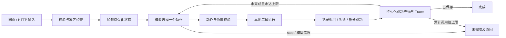

# 方案与技术取舍

## 结构

原生 Node.js HTTP 服务托管无构建步骤的 HTML/CSS/ES Modules。Agent、模型适配器、本地工具和文件持久化分层；未使用第三方 Agent 框架。Node 24.15.0 下验证，测试框架为内置 `node:test`。



## 动态决策的准确边界

`src/agent.js` 每轮调用 `model.decide(task)`。真实适配器向 Chat Completions 兼容接口提交输入、当前状态、成功产物、剩余调用数和完整工具观察。模型输出一个 JSON 动作：

```json
{"tool":"search_materials","arguments":{"tier":"standard"},"reason":"初始方案超预算，检索轻量素材。"}
```

运行器校验工具白名单、参数对象、行动依据长度，然后执行工具；返回结果进入下一轮模型请求。模型可改变素材等级、选择已有产物、保存或停止。运行器在工具失败后不会自动按固定顺序重试，而是把异常作为 observation 交给模型。

`MockModel` 是确定性离线测试替身：用真实执行结果触发替代策略。其分支用于工程验证，不宣称符合真实模型 ReAct 证明。适配器协议测试伪造的是 HTTP 响应，不是真实模型结果，也不作为决策效果证据。

真实模式固定使用合成的本地业务工具；脚本生成工具是模板，不把模板文案宣传为模型创作。为降低复杂度，采用模型输出 JSON 动作后由运行器 dispatch 的工具协议，不依赖 SDK 原生 function-calling 格式。接口要求支持 `response_format: json_object`。

## 状态与依赖

任务状态包括 `queued`、`running`、`resuming`、`completed`、`needs_input`、`incomplete`。终止原因码区分 `budget_exceeded`、`deadline_exceeded`、`tool_failed`、`model_error`、`step_limit` 等。工具步骤记录 `success`、`failed`、`partial`；估算工具成功与「方案可行」是两个维度：成功算出超预算结果时，工具状态成功、`feasible=false`。

素材 → 脚本 → 估算 → 保存，依次引用已存在 id。保存工具重新检查来源、成本与当前剩余时间，不能只相信模型给出的结论或陈旧的可行估算。费用合计是最终方案的素材费与制作费；替代方案的估算不累加为真实支出。

结果按素材/脚本/估算分别保留，切换轻量素材不删除精选脚本。一次性故障注入的消费标记随任务一起保存。保存失败后可加载持久化状态，从已有估算继续。服务启动时将意外中断的运行状态改为 `incomplete/process_interrupted`，等待显式续跑。

## 幂等、上限与持久化

- `requestKey` 配合规范化后的核心输入决定去重。相同 key、不同输入为 409；相同 key、相同输入始终返回原任务，不隐式重跑失败步骤。
- 重复请求不重新消费故障注入，不新增记录或制作费用。新的执行须用新 key；续跑使用独立 endpoint。
- 每个任务用内存 Promise 锁避免同一进程并发执行。每次工具结果以临时 JSON 文件 + 原子 rename 保存，方便评审核对；JSON 存储不支持跨进程竞争。
- 默认总工具调用上限为 12，可配置 1–32；失败调用同样计入，续跑不重置。模型请求默认 90 秒超时，可通过 `OPENAI_TIMEOUT_MS` 配置为 1000–180000 毫秒；非法值启动时拒绝。当前未做令牌预算或总墙钟超时。

真实运行后将规划提示明确为 `quality-first-v2`：先生成并估算精选方案，再根据实际工具观察决定是否替代。工具执行骨架与质量优先策略是预设的，但每轮动作仍由接口返回，运行器不替模型生成替代决定。每条真实决策保留策略版本与系统提示哈希，便于区别改进前后的记录。

## 前端与数据处理

暖白与橙色工作台，含响应式侧栏、状态统计、任务表单、四步计划、脚本分镜、费用条和逐步轨迹。前端轮询 API 获取实际状态，不用定时器伪造进度。动态用户文本经 HTML 转义；密钥只在服务端读取；静态资源限制在 public 目录并设 CSP。部署定位是单用户本地工具，没有生产级身份认证。

## 取舍

不采用框架是为了在有限时间内让状态、执行边界和故障处理容易解释。保留模型接口注入点与纯工具函数，方便测试。文件存储减少环境配置，但扩展到多人服务应改为事务数据库和后台队列。合成资料库与模板脚本验证的是规划机制，无法证明真实检索覆盖或内容质量。
